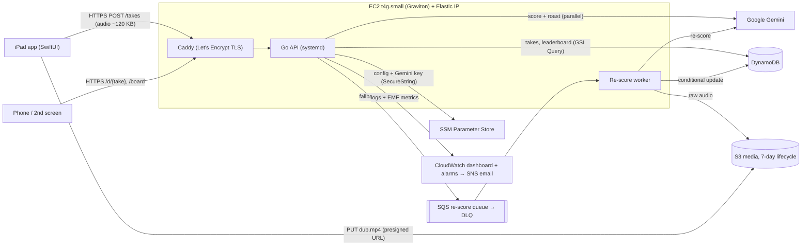

# LARPStudio

**A voice-over party game for the iPad. Code scores your timing; an AI judge scores your taste.**

Players watch a muted ~15-second movie clip and improvise the voice acting live. LARPStudio scores *when* they spoke with deterministic code, has Google Gemini *listen* to the raw audio to judge emotion and comedy, and delivers a talent-show-style roast. Players leave with a QR code to their dub, and everyone's on the leaderboard.

> Timing and delivery are hard to practice alone because nobody gives you feedback. LARPStudio scores both in about 15 seconds.

Built at **SunHacks 2026** (ASU, Nov 14–15).

---

## How it plays

1. **Consent and nickname.** One line of disclosure: your voice is recorded, sent to Google Gemini for scoring, and deleted after 7 days. No accounts.
2. **Pick a clip** from four public-domain / CC-BY dialogue scenes.
3. **Preview** it with the original audio.
4. **Countdown and record.** The clip plays muted; the iPad's built-in mic records while a live soundwave reacts to your voice.
5. **Instant replay** of your dub over the clip.
6. **Scorecard.** "Judges deliberating…", then timing, emotion, comedy and overall count up one at a time, and the roast types out in a speech bubble. A timing bar draws your speech under the character's lines.
7. **Share and leaderboard.** A QR code opens your dub on your phone (with a delete-my-take button); `/board` shows the live leaderboard on a second screen.

## Hybrid scoring: "code scores timing, AI scores taste"

| Score | Who decides | How |
|---|---|---|
| **Timing** (0–100) | Code, deterministic | The iPad runs an RMS-energy voice-activity detector on the mic input. The server computes time-IoU between the player's speech segments and the clip's reference speech windows (from Silero VAD on the original dialogue, hand-checked). Up to 0.2 s early or late is free. |
| **Emotion, comedy** (0–10) | Gemini, temperature 0 | Gemini gets the **raw audio**, not a transcript, plus a timeline of the clip's beats ("0:04 he slams the door → anger"). It judges *how* you said it, which a speech-to-text pipeline would throw away. Strict JSON schema output. |
| **Roast** | Gemini, higher temperature | A separate parallel call writes a one-line verdict. Both prompts roast the **performance, never the person**: no comments on voice, accent, speech differences or identity. |
| **Overall** | Code | `0.5 × timing + 0.5 × (emotion + comedy) / 2 × 10` |

Half of every score is deterministic, so Gemini never touches timing. Example (unit-tested): on a 3 s line, being 0.5 s late scores 77 instead of 100.

## Architecture



Three rules hold everywhere:
- **Media never touches the server.** The iPad uploads the dub video straight to S3 with a presigned URL. QR codes point at `/d/{take_id}`, which signs a fresh S3 URL on every visit, so links don't expire with the server's temporary credentials.
- **Credentials never touch the app or the box.** The Gemini key lives in SSM Parameter Store (encrypted with KMS); the server uses an IAM instance role with no long-lived keys.
- **Data expires in 7 days.** An S3 lifecycle rule deletes media, and DynamoDB TTL deletes take rows, matching the consent screen.

## AWS services

All infrastructure is one CloudFormation stack (`infra/template.yaml`).

| Service | Role |
|---|---|
| **EC2** + Elastic IP | Always-on Go API (no cold starts on the live scoring path); IMDSv2, encrypted gp3 |
| **S3** | Dub videos and raw take audio; presigned PUT/GET; 7-day lifecycle; public access blocked, HTTPS-only, SSE |
| **DynamoDB** | `takes`, `clips`, `players` tables, on-demand. Leaderboards come from GSIs (`by_clip`, `global_board`) with one descending Query and never a Scan. TTL on `expires_at` |
| **SQS** | Async re-scoring of fallback takes, with a dead-letter queue (details below) |
| **IAM** | Least-privilege instance role scoped to these tables, one bucket's prefixes, one queue and one SSM path |
| **Systems Manager** | Parameter Store for config and the Gemini key; Session Manager instead of SSH; Run Command for deploys |
| **KMS** | Decrypts the SecureString, allowed only through SSM |
| **CloudWatch** | Logs, Embedded Metric Format metrics, a `dubstudio` dashboard, and alarms on the fallback rate and the dead-letter queue |
| **SNS** | Alarm emails |
| **AWS Budgets** | $20/month cost alert |
| **CloudFormation** | Everything above, deployed and torn down by scripts in `infra/` |

### Surviving a Gemini outage with SQS

During the event, Gemini went down for us twice: models timing out, then prepaid credits running out. Players still get a scorecard right away: the real timing score, a "judges are on a coffee break" roast and a placeholder 5 for emotion and comedy. Behind the scenes:

1. The server keeps the raw take audio in S3 and puts the `take_id` on an SQS queue.
2. A worker long-polls the queue, loads the audio from S3 and asks Gemini again.
3. If Gemini answers, a **conditional** DynamoDB update writes the real scores; the leaderboard GSIs re-sort the take automatically. A take that was deleted or already re-scored is never overwritten (SQS is at-least-once).
4. If Gemini is still down, the message isn't deleted. It reappears after the 2-minute visibility timeout, which is a free backoff. After 20 tries (~40 min) it moves to a dead-letter queue, which raises a CloudWatch alarm.

The worker handles one take at a time on purpose, so a backlog after an outage can't use up the Gemini quota live players need.

## Reliability and measured numbers

- **Timeouts and model fallback:** 15 s per Gemini attempt with one retry. The retry switches to a different model (`gemini-4-hydrogen` → `gemini-3.5-flash`), because a busy model rarely recovers within seconds. Schema violations and out-of-range scores count as failures.
- **No-audio guard:** silent or empty takes (peak below −45 dBFS) skip Gemini, which otherwise invented scores for silence.
- **Latency, end of take → scorecard** (Gemini-scored takes on the live server, 24 h, n = 17): **p50 6.2 s, p95 18.8 s**. The "judges deliberating" animation covers it, and the CloudWatch dashboard tracks it live.

## What we learned

- **Voice processing silently stopped the audio engine.** Turning on Apple's echo cancellation reconfigured the audio hardware and stopped `AVAudioEngine` without an error, so every take was empty and scored 25. Fix: restart on `AVAudioEngineConfigurationChange`, plus a watchdog on the input tap.
- **Bluetooth headphones change the mic.** Using the AirPods' mic switches iOS to the low-quality hands-free profile. We record with the iPad's built-in mic, keep the AirPods on high-quality A2DP output only, and turn voice processing off when headphones are connected (it forced Bluetooth back to hands-free).
- **A SwiftUI freeze on "That's a wrap!"** SwiftUI rendered with the old value during `@Published`'s willSet and never re-rendered. We reproduced it 3 out of 4 times with a simulator autopilot (`-autoRecord`), fixed it, then confirmed 5 out of 5.
- **Plain IoU caps a perfect take at 88.** IoU against windows widened for tolerance penalises a perfect take, so the union uses the raw windows. A perfect take now scores 100.
- **LLMs judge silence confidently.** Gemini made up a performance from the clip's beats when the audio was empty, hence the no-audio guard.
- **AWS details:** SQS queue policies allow one resource per statement; CloudWatch alarms must match the exact dimension set the metric is emitted with; and editing a security group's description replaces it.

## Next steps

- **Language-learning shadowing:** learners dub native-speaker clips, and the same timing score measures whether they keep pace.
- **Scaling:** move the re-score worker to Lambda triggered by SQS, and put the API behind a load balancer with an Auto Scaling group across two Availability Zones. The bottleneck is Gemini's rate limit, not CPU, so workers would scale on queue depth.
- **CloudFront** in front of the dubs for faster share-page playback.
- **Measure judge consistency:** score the same take five times and report the spread of each Gemini sub-score.
- **Spoken roasts** with Gemini text-to-speech.

## Repository layout

```
ios/       SwiftUI iPad app (XcodeGen: ios/project.yml → DubStudio.xcodeproj)
server/    Go API: timing IoU, Gemini judge, DynamoDB/S3/SQS, share + board pages   → server/README.md
infra/     CloudFormation template + deploy/push/seed/logs/teardown scripts        → infra/README.md
clips/     Clip prep (download, trim, VAD) and clips.json                          → clips/README.md
prompts/   Scorer and roaster system prompts
```

(Some internal names, such as the Xcode project and AWS resources, still use the project's original name, `dubstudio`.)

## Running it

**Server locally** (in-memory store; mock scores if no Gemini key):

```bash
cd server
cp .env.example .env     # add GEMINI_API_KEY for real scoring
make run                 # http://localhost:8080
make test                # go vet + tests
```

**AWS** (from `infra/`, after `aws login`):

```bash
./deploy.sh you@example.com   # create/update the stack; email gets budget + alarm alerts
./push.sh                     # build the arm64 binary, ship via S3 + SSM Run Command, restart
./seed.sh                     # load clips/clips.json into DynamoDB
./logs.sh 30m                 # readable live take log
./teardown.sh --yes           # delete everything
```

**iPad app:** `cd ios && xcodegen` (if `project.yml` changed), open `DubStudio.xcodeproj`, choose your iPad and run. Long-press the logo for the debug sheet (server URL, audio route, take log).

## Clip credits

- **Tears of Steel** (2012): © Blender Foundation, CC-BY 3.0, mango.blender.org. Clips are trimmed and the audio is replaced by the player's dub.
- **Night of the Living Dead** (1968, dir. George A. Romero): public domain, via the Internet Archive.
- **His Girl Friday** (1940, dir. Howard Hawks): public domain, via the Internet Archive.

Full sources and license notes: [`clips/README.md`](clips/README.md).
