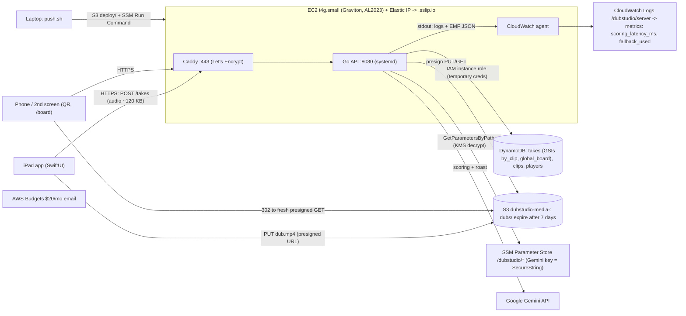

# LARPStudio infra (AWS, us-west-2)

One CloudFormation stack (`dubstudio`, `template.yaml`) plus four scripts. No SSH and no access keys on the server.

## Architecture



ASCII version for a slide:

```
 iPad ──HTTPS──▶ Caddy (TLS, <eip>.sslip.io) ──▶ Go API on EC2 t4g (systemd, IAM role)
   │                                               │  ├─▶ DynamoDB  takes ─GSI by_clip / global_board─▶ leaderboard (Query, no Scan)
   │                                               │  ├─▶ SSM Parameter Store (Gemini key, SecureString)
   │                                               │  ├─▶ Gemini (score + roast, 10 s timeout, fallback)
   │                                               │  └─▶ stdout EMF ─▶ CloudWatch agent ─▶ Logs + Metrics (p50/p95)
   └──presigned PUT (video never touches server)──▶ S3 dubs/  ──lifecycle: deleted after 7 days
 QR /d/<take_id> ─▶ Go signs a fresh GET URL ─▶ S3
```

## 30-second architecture pitch (for the AWS judges)

> "The iPad talks HTTPS to a Go server on a Graviton **EC2** instance with an **Elastic IP**. Caddy gets a real
> certificate for the IP's sslip.io name. We picked EC2 over Lambda because scoring is on the live demo path:
> always-on, no cold starts, and one stable address. Takes go into **DynamoDB**. The leaderboard is a single
> descending **Query on a GSI**, `by_clip` per clip and `global_board` overall. It never scans, so it stays
> single-digit ms. The server has no access keys. It uses an **IAM instance role** scoped to these three tables,
> one bucket's prefixes and our SSM path. The Gemini key is a **SecureString in Parameter Store**, and the app
> holds no secrets at all. Video never goes through the server: the iPad **PUTs straight to S3 with a presigned
> URL**, and QR links hit our server, which signs a fresh GET each time. An **S3 lifecycle rule deletes every dub
> after 7 days**, which is what our consent screen promises. **CloudWatch** turns our structured logs into latency
> and fallback metrics through EMF. A **budget alarm** caps spend, and we deploy through **SSM Run Command**, so
> there's no SSH port open."

Likely follow-ups:
- *Why not Lambda + API Gateway?* Cold starts on a 10 s Gemini path during a live demo, and a long-lived process keeps HTTP/2 connections to Gemini warm. At scale we'd move to an ASG/ALB or Fargate. The binary is stateless, so that's a deploy change, not a rewrite.
- *Why a constant `board="ALL"` partition?* At hackathon scale it gives a global top-N with one Query. At real scale we'd shard it (`ALL#0..N`) and merge, or materialize the board.
- *Least privilege?* `dynamodb:Scan` is allowed only on the tiny clips catalog. S3 access is limited to `clips/*`, `dubs/*` (and read-only `deploy/*`). `kms:Decrypt` is allowed only through SSM (`kms:ViaService`). IMDSv2 is required, the bucket blocks public access and denies non-TLS, and SSE is on everywhere.

## Deploy (once you're logged in)

Prereqs: AWS CLI v2 (≥ 2.32 for `aws login`), Go, `make`, python3, and a **default VPC** in us-west-2.

```bash
cd dubstudio/infra
aws login --region us-west-2         # browser sign-in with your console user (or: aws configure sso)
./deploy.sh you@example.com           # stack + SSM config; email gets the $20/mo budget alert (confirm it)
./push.sh                             # build linux/arm64, ship via S3 + SSM, restart, wait for https://<ip>.sslip.io/healthz
./seed.sh                             # load ../clips/clips.json into dubstudio-clips (uses your laptop creds)
```

Then on the **iPad, open Safari** to `https://<ip>.sslip.io/healthz` (the URL is in `outputs.json` → `BaseURL`). You should see `{"ok":true}` with a valid lock icon. Put the same BaseURL into the iOS app config.

All scripts are idempotent, so you can re-run them. After a server change, run `./push.sh`. To change config, re-run `./deploy.sh` (it rewrites `/dubstudio/*`) and then `./push.sh --no-build` (or just restart the service).

Options for `deploy.sh` (env vars): `ENABLE_ALARMS=true` (Tier 3 `fallback_used` alarm + email), `ENABLE_PITR=true`, `BUDGET_USD=20`, `KEY_NAME=...` (opens port 22, discouraged), `AWS_REGION`.

### Config: SSM Parameter Store → `/opt/dubstudio/env`
`deploy.sh` writes `/dubstudio/{MEDIA_BUCKET,PUBLIC_BASE_URL,TAKES_TABLE,CLIPS_TABLE,PLAYERS_TABLE,STORE,PORT,CLIPS_FILE,GEMINI_MODEL}`. It also stores `GEMINI_API_KEY` as a SecureString, read from `../server/.env` and never echoed. On every service start, `ExecStartPre` runs `fetch-env.sh`, which turns `/dubstudio/*` into `KEY=value` lines (root-only, 0600) and adds `AWS_REGION`.

### Debugging
```bash
aws ssm start-session --target $(python3 -c 'import json;print(json.load(open("outputs.json"))["InstanceId"])')
#   sudo systemctl status dubstudio caddy ; sudo tail -f /var/log/dubstudio/server.log ; sudo journalctl -u caddy -n 50
aws logs tail /dubstudio/server --follow          # server stdout (+ first-boot log in the *-bootstrap stream)
```
The first boot takes about 2–3 minutes: it installs the CloudWatch agent and Caddy, then waits for the EIP before requesting the cert.

### Notes for the Go server
- Print logs **and EMF JSON objects to stdout, one per line**. The CloudWatch agent ships `/var/log/dubstudio/server.log` to `/dubstudio/server`, and CloudWatch Logs extracts EMF metrics automatically. For the optional alarm, emit `fallback_used` in namespace `DubStudio` with an empty dimension set (`"Dimensions": [[]]`).
- Credentials come from the default AWS SDK chain (the instance role via IMDSv2). Set no keys.
- The takes and players tables have TTL enabled on `expires_at` (epoch seconds). It's optional: set it if you want rows to expire with the 7-day promise.

## Teardown
```bash
./teardown.sh --yes   # empties the bucket, deletes the stack (EC2, EIP, tables, bucket, role), deletes /dubstudio/* params
```
An Elastic IP is billed whenever it isn't attached, so tear down after the event.

## Files
| File | What |
|---|---|
| `template.yaml` | The whole stack: 3 DynamoDB tables + GSIs, S3 bucket (7-day `dubs/` expiry, CORS, TLS-only), IAM role/profile, SG, EIP, EC2 (IMDSv2, UserData installs Caddy + CW agent), log group, budget, optional alarm |
| `deploy.sh` | Deploys the stack, writes `outputs.json` (gitignored) and SSM params |
| `push.sh` | Builds, uploads a bundle to `s3://…/deploy/`, runs `remote/install.sh` through SSM Run Command, polls `/healthz` |
| `seed.sh` | Runs `server/cmd/seedclips` locally against `dubstudio-clips` |
| `teardown.sh` | Deletes everything (requires `--yes`) |
| `dubstudio.service` | systemd unit (non-root `dubstudio` user, `Restart=always`, hardened) |
| `Caddyfile.tmpl` | `__HOST__` → `<eip>.sslip.io`, reverse proxy to :8080 |
| `remote/` | Scripts that run **on the instance** (`install.sh`, `fetch-env.sh`) |
